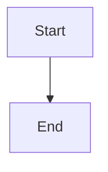
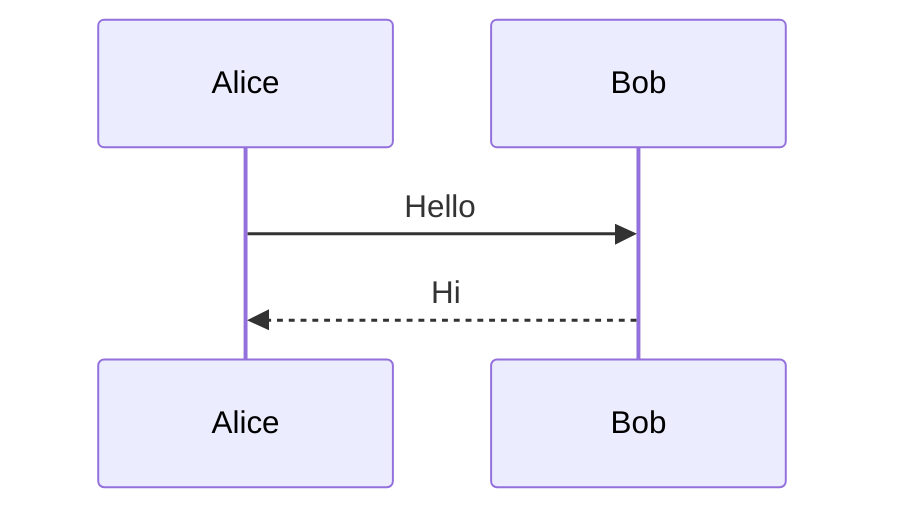

# E2E Test Implementation Plan

> **For agentic workers:** REQUIRED SUB-SKILL: Use superpowers:subagent-driven-development (recommended) or superpowers:executing-plans to implement this plan task-by-task. Steps use checkbox (`- [ ]`) syntax for tracking.

**Goal:** HonKitでテスト用ブックをビルドし、Mermaid図がSVG/PNGとして正しく出力されることを検証するE2Eテストを構築する。

**Architecture:** `test/fixtures/test-book/` に最小限のHonKitブックを配置。Jest の `beforeAll` でシンボリックリンク作成 → `honkit build` / `honkit pdf` 実行。cheerio でHTML出力を検証。Calibre未インストール環境ではPDFテストを自動スキップ。

**Tech Stack:** Jest, cheerio, HonKit, @mermaid-js/mermaid-cli

---

### Task 1: テストフィクスチャの作成

**Files:**
- Create: `test/fixtures/test-book/book.json`
- Create: `test/fixtures/test-book/SUMMARY.md`
- Create: `test/fixtures/test-book/README.md`
- Create: `test/fixtures/test-book/puppeteer-config.json`

- [ ] **Step 1: book.json を作成**

```json
{
  "plugins": ["mermaid-newface"],
  "pluginsConfig": {
    "mermaid-newface": {
      "theme": "default"
    }
  }
}
```

- [ ] **Step 2: SUMMARY.md を作成**

```markdown
# Summary

* [Introduction](README.md)
```

- [ ] **Step 3: README.md を作成（テスト用mermaidコードブロックを含む）**

````markdown
# Test Book

## Flowchart



## Sequence Diagram



## Normal Code Block

```javascript
console.log("hello");
```
````

- [ ] **Step 4: puppeteer-config.json を作成**

```json
{
  "args": ["--no-sandbox"]
}
```

- [ ] **Step 5: コミット**

```bash
git add test/fixtures/test-book/
git commit -m "test: add HonKit test book fixture"
```

---

### Task 2: devDependencies の追加と package.json 更新

**Files:**
- Modify: `package.json`

- [ ] **Step 1: devDependencies を追加**

```bash
npm install --save-dev jest cheerio honkit
```

- [ ] **Step 2: package.json に test script を追加**

`package.json` の `"devDependencies"` ブロックの上あたりに `"scripts"` を追加:

```json
{
  "scripts": {
    "test": "jest --testTimeout=120000"
  }
}
```

- [ ] **Step 3: インストールを確認**

```bash
npm test -- --version
```

Expected: Jest のバージョン番号が表示される（例: `29.x.x`）

- [ ] **Step 4: コミット**

```bash
git add package.json package-lock.json
git commit -m "test: add jest, cheerio, honkit as devDependencies"
```

**注意:** このプロジェクトは元々 `yarn.lock` を使用している。`npm install` 実行時に `package-lock.json` が新規生成される。どちらのロックファイルを使うかはユーザー判断に委ねる。yarn を使い続ける場合は `npm install` の代わりに `yarn add --dev jest cheerio honkit` を実行し、`yarn.lock` をコミットすること。

---

### Task 3: Website（SVG）E2Eテストの作成

**Files:**
- Create: `test/e2e.test.js`

- [ ] **Step 1: テストファイルを作成（セットアップ + Website テスト）**

```javascript
const { execSync } = require('child_process');
const path = require('path');
const fs = require('fs');
const cheerio = require('cheerio');

const BOOK_DIR = path.resolve(__dirname, 'fixtures/test-book');
const BOOK_OUTPUT = path.join(BOOK_DIR, '_book');
const PLUGIN_ROOT = path.resolve(__dirname, '..');
const SYMLINK_PATH = path.join(BOOK_DIR, 'node_modules', 'gitbook-plugin-mermaid-newface');

const execOpts = { cwd: BOOK_DIR, stdio: 'pipe', timeout: 120000 };

beforeAll(() => {
  // Create symlink: test-book/node_modules/gitbook-plugin-mermaid-newface -> project root
  fs.mkdirSync(path.join(BOOK_DIR, 'node_modules'), { recursive: true });
  if (fs.existsSync(SYMLINK_PATH)) {
    fs.rmSync(SYMLINK_PATH, { recursive: true });
  }
  fs.symlinkSync(PLUGIN_ROOT, SYMLINK_PATH, 'dir');

  // Build the book (website output)
  execSync('npx honkit build', execOpts);
});

afterAll(() => {
  // Clean up build output and symlink
  if (fs.existsSync(BOOK_OUTPUT)) {
    fs.rmSync(BOOK_OUTPUT, { recursive: true });
  }
  if (fs.existsSync(SYMLINK_PATH)) {
    fs.rmSync(SYMLINK_PATH, { recursive: true });
  }
  // Remove node_modules dir if empty
  const nmDir = path.join(BOOK_DIR, 'node_modules');
  if (fs.existsSync(nmDir) && fs.readdirSync(nmDir).length === 0) {
    fs.rmdirSync(nmDir);
  }
});

describe('Website (HTML/SVG) output', () => {
  let $;

  beforeAll(() => {
    const html = fs.readFileSync(path.join(BOOK_OUTPUT, 'index.html'), 'utf-8');
    $ = cheerio.load(html);
  });

  test('flowchart is rendered as SVG', () => {
    const svgs = $('svg');
    // At least one SVG should contain mermaid flowchart content
    const hasMermaidSvg = svgs.toArray().some(svg => {
      const content = $(svg).html();
      return content.includes('Start') || content.includes('End');
    });
    expect(hasMermaidSvg).toBe(true);
  });

  test('sequence diagram is rendered as SVG', () => {
    const svgs = $('svg');
    const hasSequenceSvg = svgs.toArray().some(svg => {
      const content = $(svg).html();
      return content.includes('Alice') || content.includes('Bob');
    });
    expect(hasSequenceSvg).toBe(true);
  });

  test('normal code block is NOT converted to SVG', () => {
    const codeBlocks = $('code');
    const hasJsBlock = codeBlocks.toArray().some(el => {
      return $(el).text().includes('console.log');
    });
    expect(hasJsBlock).toBe(true);
  });
});
```

- [ ] **Step 2: テストを実行して Website テストが通ることを確認**

```bash
npm test
```

Expected: 3 tests passed

- [ ] **Step 3: コミット**

```bash
git add test/e2e.test.js
git commit -m "test: add website (SVG) E2E tests"
```

---

### Task 4: PDF（PNG data URI）E2Eテストの追加

**Files:**
- Modify: `test/e2e.test.js`

- [ ] **Step 1: Calibre 検出ヘルパーを追加**

`test/e2e.test.js` の `const execOpts = ...` 行の後に追加:

```javascript
function hasCalibre() {
  try {
    execSync('which ebook-convert', { stdio: 'pipe' });
    return true;
  } catch {
    return false;
  }
}
```

- [ ] **Step 2: PDF テストの describe ブロックを追加**

`test/e2e.test.js` の末尾（最後の `});` の後）に追加:

```javascript
const describePdf = hasCalibre() ? describe : describe.skip;

describePdf('PDF (PNG data URI) output', () => {
  const pdfPath = path.join(BOOK_DIR, 'output.pdf');

  beforeAll(() => {
    execSync('npx honkit pdf . output.pdf', execOpts);
  });

  afterAll(() => {
    if (fs.existsSync(pdfPath)) {
      fs.rmSync(pdfPath);
    }
  });

  test('honkit pdf completes successfully', () => {
    expect(fs.existsSync(pdfPath)).toBe(true);
  });

  test('output PDF has non-trivial file size', () => {
    const stats = fs.statSync(pdfPath);
    // A PDF with embedded PNG diagrams should be at least a few KB
    expect(stats.size).toBeGreaterThan(1024);
  });
});
```

- [ ] **Step 3: テスト実行**

```bash
npm test
```

Expected:
- Calibreがある環境: 5 tests passed
- Calibreがない環境: 3 tests passed, 1 test suite skipped

- [ ] **Step 4: コミット**

```bash
git add test/e2e.test.js
git commit -m "test: add PDF (PNG data URI) E2E tests with Calibre detection"
```

---

### Task 5: GitHub Actions CI ワークフローの作成

**Files:**
- Create: `.github/workflows/test.yml`

- [ ] **Step 1: ワークフローファイルを作成**

```yaml
name: E2E Test

on:
  push:
    branches: [master, feature/**]
  pull_request:
    branches: [master]

jobs:
  test:
    runs-on: ubuntu-latest
    strategy:
      matrix:
        node-version: [18, 20]
    steps:
      - uses: actions/checkout@v4

      - uses: actions/setup-node@v4
        with:
          node-version: ${{ matrix.node-version }}

      - name: Install dependencies
        run: npm install

      - name: Install Calibre (for PDF tests)
        run: sudo apt-get update && sudo apt-get install -y calibre

      - name: Run E2E tests
        run: npm test
```

- [ ] **Step 2: ワークフロー構文を検証**

```bash
cat .github/workflows/test.yml | head -5
```

Expected: `name: E2E Test` が表示される（ファイルが正しく作成されたことの確認）

- [ ] **Step 3: コミット**

```bash
git add .github/workflows/test.yml
git commit -m "ci: add E2E test workflow for Node 18/20"
```

---

### Task 6: .gitignore の更新と最終確認

**Files:**
- Modify or Create: `.gitignore`

- [ ] **Step 1: .gitignore にテスト成果物を追加**

以下のエントリを `.gitignore` に追加（既存ファイルがあれば末尾に追記、なければ新規作成）:

```
test/fixtures/test-book/_book/
test/fixtures/test-book/node_modules/
test/fixtures/test-book/output.pdf
```

- [ ] **Step 2: 全テストを実行して最終確認**

```bash
npm test
```

Expected: 全テストが通る（PDF テストはCalibre有無で skip or pass）

- [ ] **Step 3: コミット**

```bash
git add .gitignore
git commit -m "chore: add test artifacts to .gitignore"
```

- [ ] **Step 4: ブランチの状態を確認**

```bash
git log --oneline feature/e2e-test --not master
```

Expected: Task 1〜6 のコミットが表示される
